# CV-vehicle-detection

Computer vision course project: detecting moving vehicles in data from a DAS system. A fiber optic cable along Jana Pawła II street works like many vibration sensors in one line: every 5.1 m of the cable is one channel, and every channel measures the strain rate 625 times per second. A vehicle driving along the street shakes the next places of the cable one after another, so in a table of time and position it makes a slanted line, and the slope of this line is its speed.

We use the synthetic data, which has the ground truth, to build and check our methods, and then use them to detect vehicles in the real data. Only classical methods are used (NumPy, OpenCV, Matplotlib, no neural networks). The steps and results are described in `docs/report.pdf`.

**Real data:** three 2-minute segments. 09:10:52-09:12:52 and 09:12:22-09:14:22 are the segments assigned to us, 09:18:52-09:20:52 is the third segment we chose (it does not overlap the other two).

## Algorithm

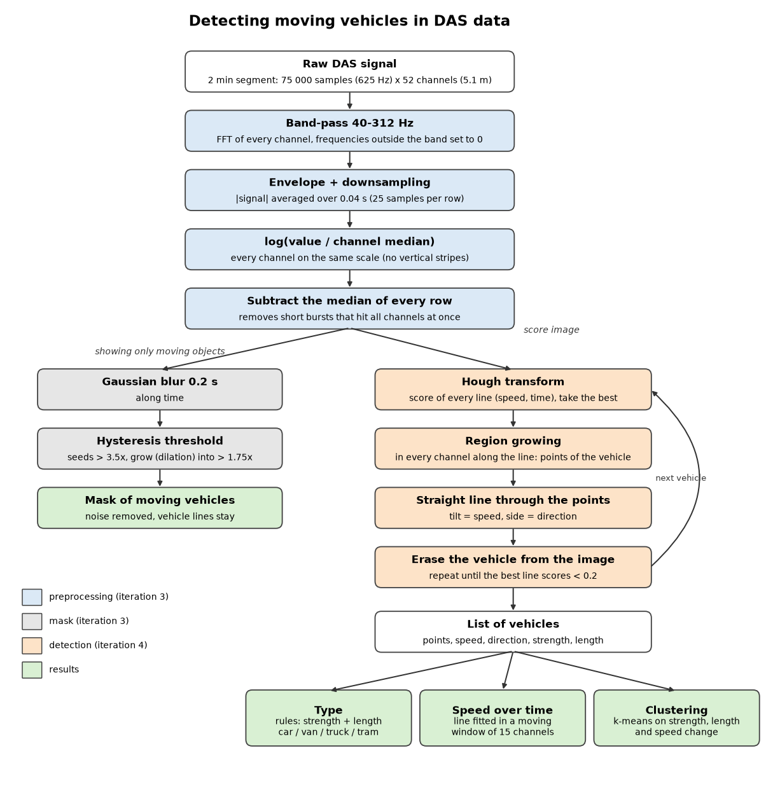

1. **Band-pass 40-312 Hz.** The FFT of every channel, frequencies outside the band are set to 0. In this band the vehicles are visible on the cleanest background.
2. **Envelope.** |signal| averaged over 0.04 s, so the image gets 25 times smaller (3 000 rows instead of 75 000 for 2 minutes).
3. **log(value / channel median).** Every place on the cable has its own noise level, after this step all channels are on the same scale.
4. **Row median.** Subtracting the median of every row removes short bursts that hit all channels at the same moment (horizontal stripes). This gives the score image.
5. **Mask.** Gaussian blur along time and a hysteresis threshold: pixels above 3.5x the channel median are seeds and they grow (repeated dilation) into the pixels above 1.75x. Faint parts of a line stay only when they touch a strong part, so faint cars are kept and random noise is not.
6. **Detection** on the score image. The Hough transform scores every possible line (speed and time) and takes the best one. Along this line, region growing finds the vehicle in every channel. A straight line through these points gives the speed and the direction. Then the vehicle is erased from the image and the next best line is taken, until no line has a high enough score.
7. **For every vehicle:** its type (rules on strength and length), its speed over time (a line fitted in a moving window of 15 channels) and a group from clustering (k-means).

## Results

**Frequency analysis.** The FFT of every channel, split into frequency bands (09:12:22, every image is one band). In the 40-100 Hz and 100-312 Hz bands almost all vehicles are visible on a clean background, the lower bands have much more noise and horizontal stripes.

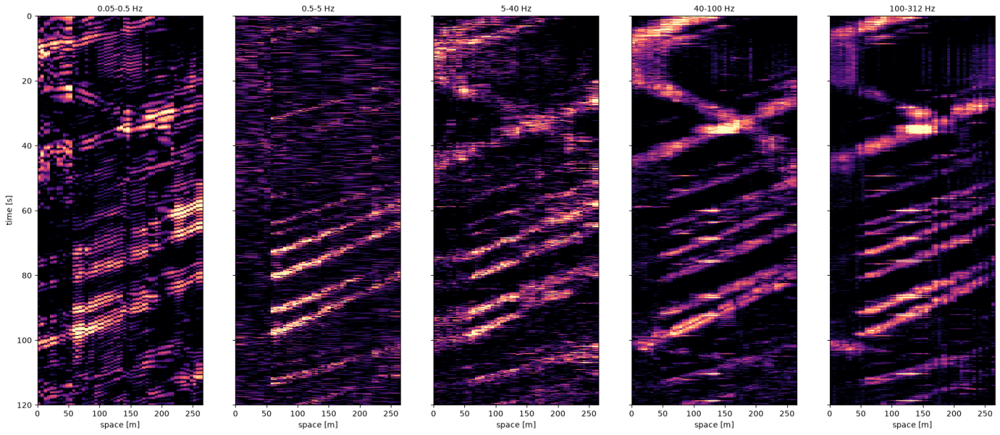

**Denoising.** The best chain from the search on synthetic data (A) marks a third of the real image as vehicles, because its percentile threshold assumes there is always the same amount of traffic. Our chain (BEST) was chosen on a hand-made reference (60 points on vehicles and 9 empty areas): false alarms in the empty areas went down from 4.5% to 0.7%, 96-100% of the points are still hit and there is almost no small noise left.

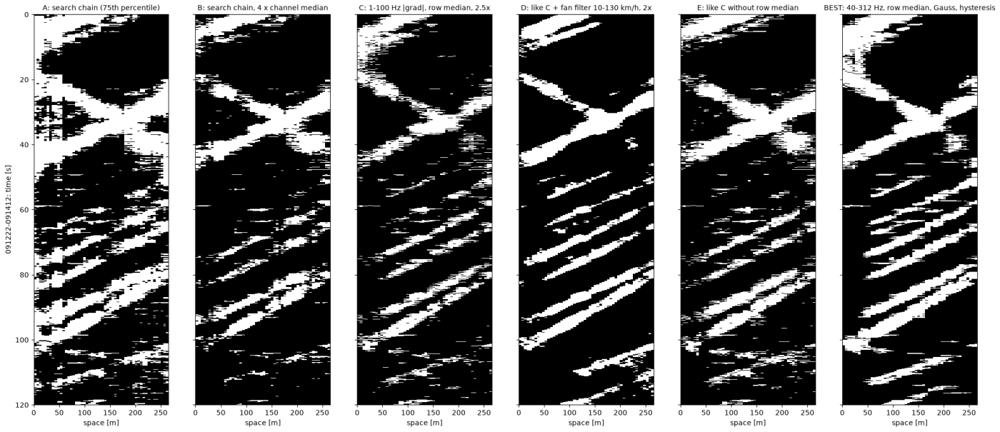

Before and after on 09:12:22: |signal|, the score image and the final mask.

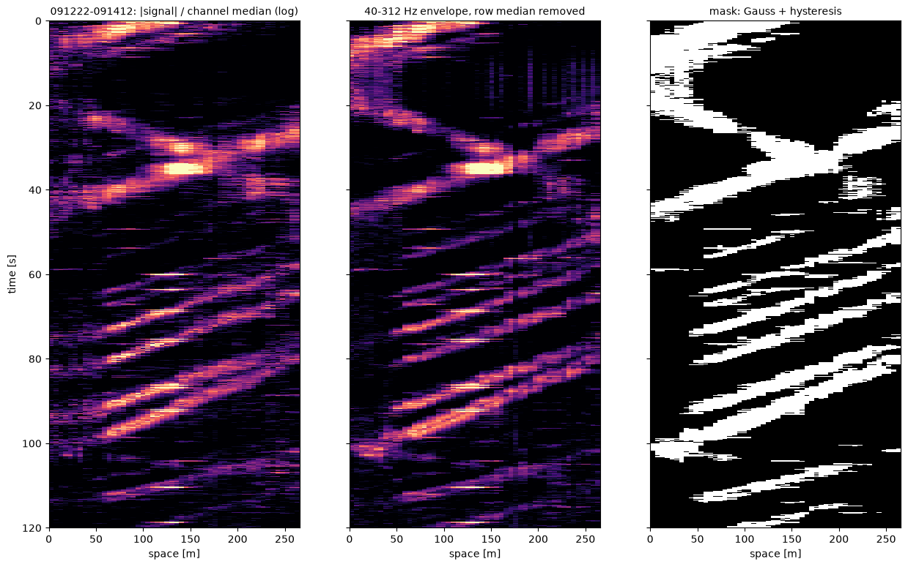

The same chain on the whole recording (09:00-09:43) marks 9-26% of the image per minute, following the traffic.

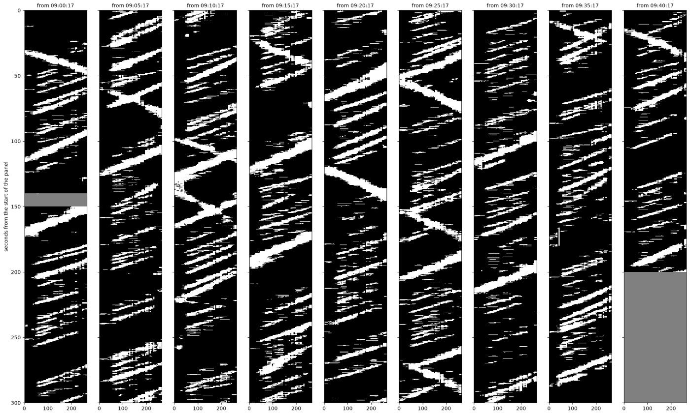

**Detection.** In the Hough space every bright spot is one vehicle (left half: driving towards larger positions, right half: towards smaller ones), so crossing vehicles are two separate spots.

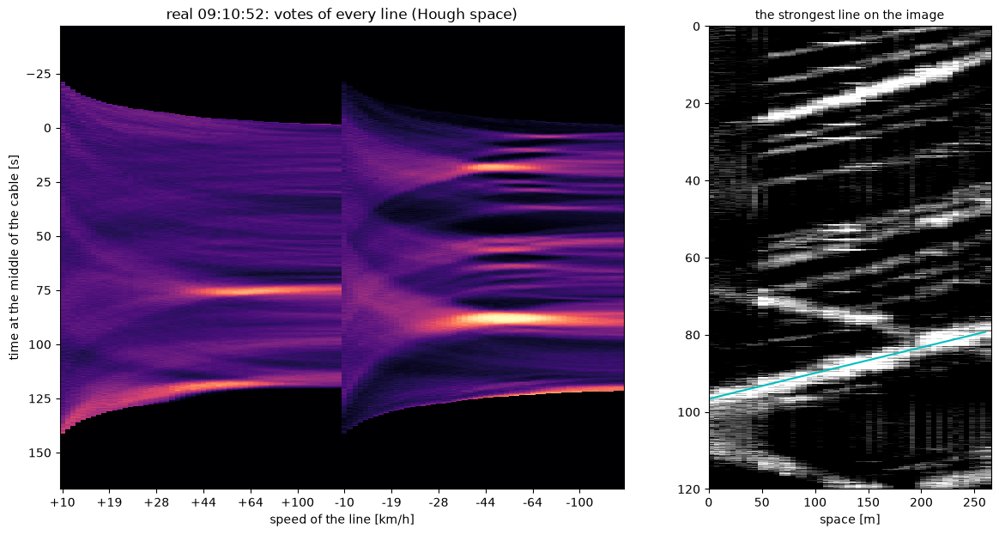

On the 6 synthetic examples 115 of 134 vehicles are found with 6 extra detections (precision 0.95, recall 0.86, F1 0.90). The direction is always correct and the median speed error is 0.73 km/h. Most of the missed vehicles are cars that are almost not visible.

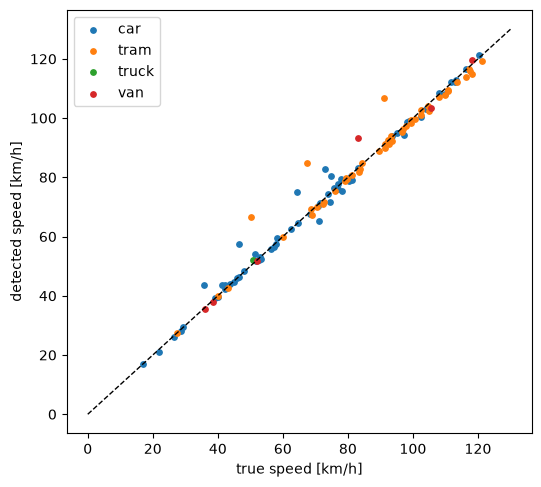

On the three real segments 85 vehicles are found, most of them driving 40-70 km/h. The colour is the type from the rules (green car, yellow van, orange truck, red tram) and the number is the speed in km/h.

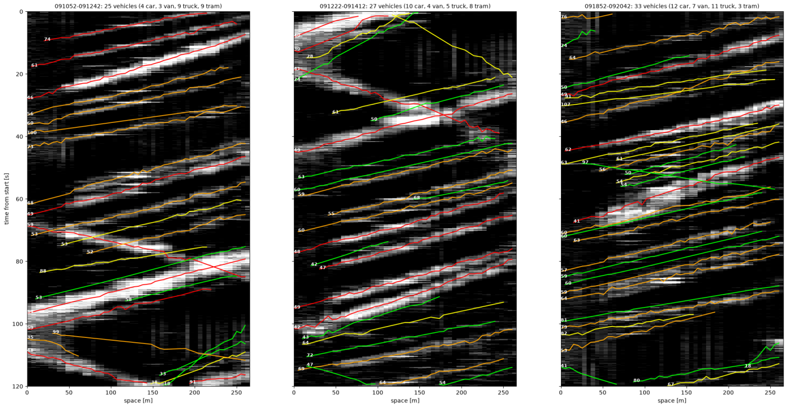

**Speed over time.** Detected speed and ground truth for the 3 synthetic vehicles whose speed changes the most. The median error at every moment is 2.17 km/h.

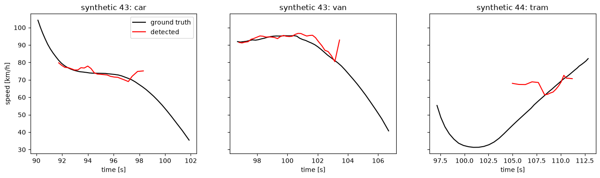

**Clustering.** k-means on strength, length and speed change splits the real vehicles into 4 groups: thin short lines (cyan, probably mostly cars), medium lines (green), lines with varying speed (yellow) and thick long lines (red, probably trams). Every point is one of the 85 vehicles from the three real segments.

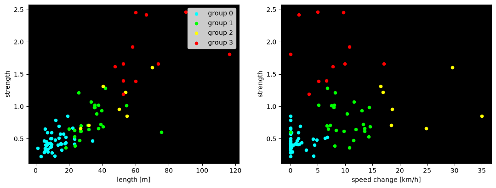

The same groups drawn on the images:

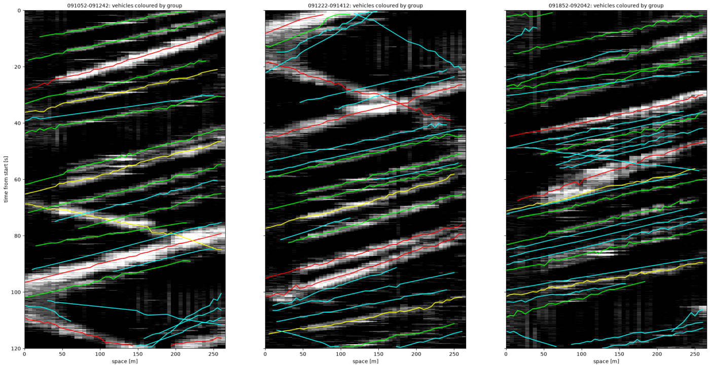

**Vehicle type.** On synthetic data the rules separate trams from the rest in 96.5% of cases, but all 4 types only in 77.4%, because the lengths of cars and vans overlap and there are only 6 vans and 1 truck to learn from.

## Limitations

- In dense traffic the Hough transform can find false steep lines that go through several vehicles.
- The first 10 channels (0-50 m of the cable) are weak in every frequency band, so many lines start only at about 50 m.
- The type rules were tuned on synthetic data, on real data the types are not reliable.
- The real data reference is hand-made, it checks hits and false alarms, not the exact shape of the lines.

## Notebooks

The notebooks are in `notebooks/`, one per iteration:

- `iteration1_methods.ipynb`: data loading, signal statistics and comparison of the first methods (abs, gradient, median normalization, opening) with ROC curves.
- `iteration2_search.ipynb`: search over every combination of steps (frequency filter, abs or grad, channel normalization, gamma and blur, percentile threshold, opening, closing), leave-one-out check and plots of the best chains.
- `iteration3_denoising_real.ipynb`: frequency analysis and a cleaner mask for the real data, checked on the hand-made reference in `annotations/real_reference.json`, on the third segment and on the whole recording. At the end it saves its score images to `images/` (not in git), which `iteration4_detection.ipynb` uses, so run it first.
- `iteration4_detection.ipynb`: detection on the images from iteration 3 (Hough transform and region growing), speed and direction of every vehicle, its type, speed over time and clustering.

## Running

Python 3.12 or newer is needed (NumPy 2.5):

```
python -m venv .venv
.venv\Scripts\activate
pip install -r requirements.txt
```

The data is not in the repository. Put it in the repository root (the notebooks switch to it when run from `notebooks/`):

```
real-world-data/
synthetic-data/
```

The search in `iteration2_search.ipynb` takes about 48 minutes the first time, then its results are read from `search_results.csv`.
